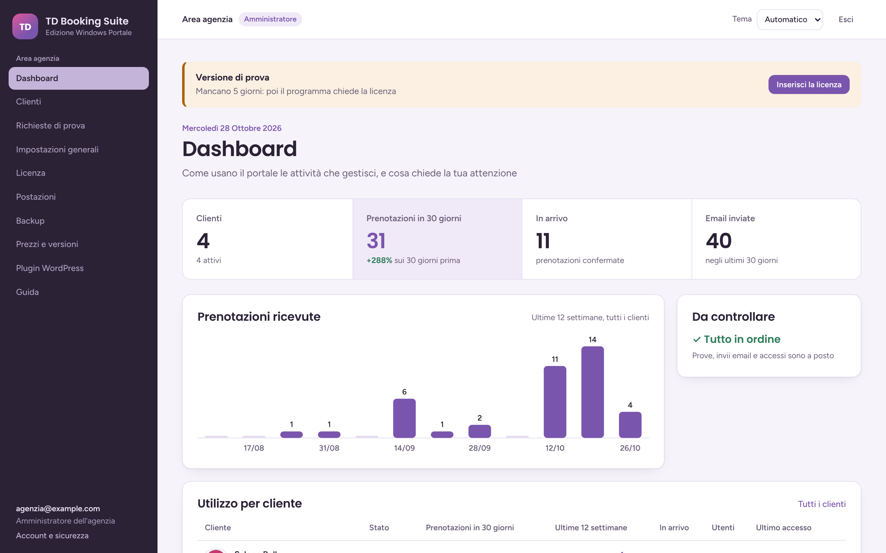

# TD Booking Suite per Windows

TD Booking Suite diventa un programma per Windows, che si installa con un file MSI:

- **Server.** Va su un solo PC, quello che resta acceso. Contiene il database PostgreSQL, il programma in HTTPS e i backup, e gira come servizio di Windows anche quando nessuno è collegato.
- **Postazione.** È la finestra di TD Booking Suite e va su ogni PC che lo usa, anche sul server. Si può usare anche da browser o telefono.

La **licenza** decide quante attività (1 = versione singola, di più = portale) e quante postazioni in rete si possono usare. Senza licenza si attiva una **prova di 7 giorni**: finita la prova, il programma chiede la licenza.

Il nucleo web è [TD Booking Suite](https://github.com/Giuseppe-sciarra/TD-Booking-Suite), incluso qui come sottomodulo in `suite/`.

| | |
|---|---|
|  |  |
| **Licenza**: cosa consente, il codice installazione da mandare a chi vende, il campo per incollarla | **Postazioni**: il codice di 6 cifre per registrare un PC, l'elenco con ultimo accesso e revoca |
|  |  |
| **Backup** cifrati, ogni notte, su disco esterno, NAS, FTP, FTPS o SFTP, con lo storico | **Prova di 7 giorni**: l'avviso in cima alle pagine dell'amministratore |
|  |  |
| **Tema scuro e colore principale a scelta**: qui verde acqua al posto del viola di serie | **Impostazioni generali**: nome, loghi chiaro e scuro, icona, colore e tema di partenza |

## Installare

### Windows segnala l'MSI: si installa lo stesso

L'MSI non ha ancora una firma digitale, quindi Windows non riconosce chi lo pubblica e lo segnala, anche se il file è a posto:

1. **Edge o Chrome**, appena scaricato, dicono che il file *non viene scaricato comunemente*. Apri il menu **…** del download e scegli **Mantieni**, poi **Mostra altro** e **Mantieni comunque**.
2. **Windows ha protetto il PC**, la finestra blu di SmartScreen, compare al doppio clic. Premi **Ulteriori informazioni** e poi **Esegui comunque**.
3. Se il file arriva da una chiavetta o da una email e non parte: tasto destro, **Proprietà**, spunta **Sblocca** in basso, **OK**.

Per togliere gli avvisi serve un certificato di firma del codice, che costa qualche centinaio di euro l'anno.

### Il PC server

1. Doppio clic sull'MSI, poi **Avanti**. Accetta la licenza d'uso.
2. In **Funzioni** lascia attivi **Server** e **Programma per la postazione**, poi **Installa** e dai il permesso di amministratore. La prima volta servono un paio di minuti: l'installer crea il database e i servizi.
3. Alla fine lascia spuntato **Apri TD Booking Suite**, oppure usa l'icona sul desktop. L'indirizzo del server è già scritto: premi **Collegati** e poi **Continua**. Si apre **Primo avvio**: crea l'**amministratore del programma**, con email e password. Da qui si configurano attività, postazioni, backup e licenza.
4. Vai in **Licenza**: incolla la licenza oppure **Attiva la prova di 7 giorni**.
5. Vai in **Clienti**, poi **Nuovo cliente**, e crea l'attività. Con la versione portale puoi crearne quante ne consente la licenza.
6. Vai in **Backup**: imposta la password dei backup, attiva il backup automatico e aggiungi almeno una destinazione fuori dal PC.

|  |  |
|---|---|
| **Primo avvio**: solo dal PC server, solo finché l'amministratore non c'è | **Dopo la prova**: restano aperte solo Licenza e Backup, e i dati sono al sicuro |

L'indirizzo del programma è `https://NOME-DEL-PC:8443`, e lo trovi nella pagina **Postazioni**. Per sceglierne un altro, installa da riga di comando:

```bat
msiexec /i TD-Booking-Suite-2.8.0.msi ADDLOCAL=Server,Postazione PORTA=8443 INDIRIZZO=https://ufficio-pc:8443 ALTRI_INDIRIZZI=192.168.1.10
```

### Le postazioni

1. Sugli altri PC installa lo stesso MSI e in **Funzioni** togli **Server**: resta solo **Programma per la postazione**.
2. Al primo avvio il programma chiede l'**indirizzo del server** e mostra l'**impronta del certificato**. Se è uguale a quella della pagina Postazioni del server, premi **Continua**.
3. Sul server, in **Postazioni**, scrivi un nome (per esempio *Reception*) e premi **Genera il codice**. Sulla postazione scrivi le 6 cifre entro 15 minuti. La registrazione si fa una volta sola.

Da **browser o telefono** basta aprire l'indirizzo del server e inserire il codice. Se il browser avvisa che la connessione non è sicura, scarica il certificato dal link nella pagina e installalo tra le autorità attendibili.

Le postazioni contano per la licenza, il PC server no. Una postazione persa si **revoca** dalla pagina Postazioni. Il programma per la postazione segue il tema chiaro o scuro di Windows; per cambiare server, clic sull'icona in alto a sinistra della finestra e poi **Cambia server**.


### Server in cloud o sedi diverse

Le sedi si collegano tutte allo **stesso server**, come postazioni: non c'è niente da sincronizzare. Il server può essere un PC dell'ufficio raggiungibile da fuori oppure un Windows in cloud. In cloud:

- installa con `INDIRIZZO=https://booking.tuodominio.it:8443` e punta il DNS sull'IP della macchina;
- apri la porta 8443 anche alla rete pubblica:
  ```powershell
  Set-NetFirewallRule -DisplayName "TD Booking Suite" -Profile Any
  ```
- ogni sede usa il programma per la postazione o il browser, con il suo codice.

Il certificato lo crea il programma. Le **passkey** funzionano solo dove Windows si fida di quel certificato: sul server ce lo mette l'installer, sulle postazioni lo puoi installare dalla pagina di registrazione. Altrove si usa **Authenticator** per il secondo fattore.

## Licenze

Le licenze le crei tu, sul tuo PC, con `licenze/td-licenze.py`. Ti servono Python 3 e `pip install cryptography`. Su Windows basta il doppio clic su `licenze/TD Licenze.cmd`.

**La prima volta**, una volta sola:

```bash
python licenze/td-licenze.py chiave
```

Il comando crea la **chiave privata**, protetta da una password, in `%APPDATA%\TD Licenze` (su Mac e Linux in `~/.td-licenze`), e stampa la **chiave pubblica**. Poi:

1. Metti la chiave pubblica in `tdwin/licenza-chiave-pubblica.txt`, fai commit e push. Da quella build in poi il programma accetta le tue licenze.
2. Copia la cartella `TD Licenze` su una chiavetta: senza la chiave privata non puoi più emettere licenze per le installazioni che esistono già.
3. La chiave privata non va mai nella repo (`.gitignore` blocca i `.pem`).

**Ogni licenza:**

```bash
python licenze/td-licenze.py            # fa le domande
python licenze/td-licenze.py crea --intestatario "Bar Roma" --attivita 1 --postazioni 3 --installazione ABCD-EFGH-IJKL-MNOP --scadenza 2027-12-31
python licenze/td-licenze.py elenco     # quelle emesse, dal registro
python licenze/td-licenze.py verifica   # incolli una licenza e vedi cosa contiene
```

Le domande sono queste:

- **attività**: 1 per la versione singola, di più per il portale;
- **postazioni in rete**, oltre al PC server;
- **codice installazione**, quello che il cliente vede nella pagina Licenza e ti manda. Vuoto vale ovunque: sono le licenze *a stock*;
- **scadenza**, vuota per sempre.

Ogni licenza esce come riga `TDBS1.…` e come file `licenze-emesse/licenza-TD-2026-0001-bar-roma.txt`, da mandare al cliente. Resta anche nel `registro-licenze.csv`.

| Cosa succede se il cliente… | |
|---|---|
| reinstalla sullo stesso PC e ripristina un backup | il codice installazione torna quello di prima e la licenza vale ancora |
| cambia PC | nuovo codice: gli mandi una licenza nuova |
| ha più attività di quelle della licenza nuova | il programma rifiuta la licenza e lo spiega |
| ha più postazioni registrate | restano attive quelle registrate per prime, finché non ne revoca |
| arriva alla scadenza | il programma si ferma come a fine prova: restano aperte Licenza e Backup |

Le licenze sono firmate con Ed25519: il programma contiene solo la chiave pubblica, quindi le verifica ma non le può creare, e funziona offline.

## Backup e ripristino

Dalla pagina **Backup** imposti:

- la **password dei backup**: senza, il file non si apre, nemmeno da chi ha installato il programma;
- l'**ora del backup**, una volta al giorno. Se il PC è spento a quell'ora, il backup parte appena si riaccende;
- quante **copie tenere**.

Ogni backup contiene il database, le chiavi che lo aprono, la licenza e il codice installazione, tutto cifrato con AES-256. Resta sul PC server in `C:\ProgramData\TD Booking Suite\backup` e viene copiato su ogni **destinazione**:

- **Disco esterno o chiavetta**: percorso come `E:\Backup TD Booking`. Se il disco è staccato, la copia sul server si fa lo stesso e nello storico vedi la destinazione non riuscita. Con due dischi alternati ogni settimana hai sempre una copia fuori dall'ufficio.
- **Cartella di rete o NAS**: `\\nome-del-nas\cartella`, con l'utente e la password del NAS. Non serve collegare l'unità in Windows.
- **FTP, FTPS, SFTP**: server, utente, password e cartella. Meglio SFTP o FTPS. Al primo collegamento il programma memorizza la chiave o il certificato del server, e poi controlla che non cambi.

Ogni destinazione ha il pulsante **Prova**, e lo **storico** dice com'è andato ogni backup. Se un backup non riesce, o i backup sono spenti, l'amministratore lo vede in cima alle pagine.

**Ripristino**: sul PC server apri menu Start, **TD Booking Suite**, **Ripristina backup**. Scegli il file `.tdbk` e scrivi la password. Il programma si ferma un minuto, rimette i dati e riparte. Il database di prima non viene cancellato: resta da parte con la data nel nome. Su un PC nuovo installa prima l'MSI, poi ripristina, poi chiedi la licenza con il nuovo codice installazione.

**Password dell'amministratore persa**: menu Start, **TD Booking Suite**, **Recupera amministratore**. Serve il PC server e un account amministratore di Windows.

## Aggiornare e disinstallare

Per aggiornare, apri l'MSI nuovo sopra quello vecchio: servizi, database e dati restano. Prima di applicare la versione nuova, l'installer salva una copia del database in `backup\prima-dell-aggiornamento.dump`.

La disinstallazione toglie programma e servizi ma lascia i dati in `C:\ProgramData\TD Booking Suite`. Per cancellarli davvero, elimina quella cartella.

## Cosa c'è sul PC server

| | |
|---|---|
| `C:\Program Files\TD Booking Suite\server` | Python, il programma, PostgreSQL 17, gli script |
| `C:\Program Files\TD Booking Suite\postazione` | il programma per la postazione (WebView2) |
| `C:\ProgramData\TD Booking Suite` | configurazione, database, licenza, certificati, backup, log |
| servizio **TDBookingDB** | PostgreSQL, solo su 127.0.0.1, porta 55432 |
| servizio **TDBookingWeb** | il programma in HTTPS sulla porta 8443 |
| servizio **TDBookingWorker** | email, promemoria e backup |

Ogni servizio gira con un suo account virtuale di Windows (`NT SERVICE\…`):

- il servizio web **non può leggere** la password del proprietario del database e ha solo i diritti sui dati, con l'isolamento tra attività del core;
- solo il worker, che fa i backup, la legge;
- la cartella dei dati la vedono solo Windows, gli amministratori e i servizi.

Il firewall apre la porta 8443 solo sulle reti private e di dominio.

## Costruire l'MSI

GitHub Actions (`.github/workflows/windows.yml`) gira a ogni push su `main`:

1. esegue i test;
2. costruisce l'MSI con `windows/build.ps1`;
3. lo installa davvero su Windows (`windows/smoke-test.ps1`): servizi e loro account, HTTPS con il certificato, un backup fatto dal worker, aggiornamento sopra, disinstallazione che lascia i dati;
4. lo mette tra gli *Artifacts* dell'esecuzione, per 30 giorni.

Con un tag `v2.8.0` crea anche una **Release** con l'MSI allegato.

Per costruirlo a mano su Windows servono Python 3.14, .NET SDK 8 e PowerShell 7:

```powershell
git clone --recurse-submodules https://github.com/Giuseppe-sciarra/TD-Booking-Suite-Windows
cd TD-Booking-Suite-Windows
pwsh windows/build.ps1
```

Per prendere l'ultima versione del core:

```bash
git submodule update --remote suite && git commit -am "Core aggiornato"
```

## Struttura

| | |
|---|---|
| `suite/` | il core web, sottomodulo del repository pubblico |
| `tdwin/` | l'app Django dell'edizione Windows: licenza, postazioni, primo avvio, HTTPS, certificati, backup e ripristino |
| `licenze/` | il programma per creare le licenze, solo per chi vende |
| `windows/client/` | il programma per la postazione, C# .NET Framework 4.8 con WebView2 |
| `windows/wix/` | l'MSI, WiX 5 |
| `windows/script/` | configurazione del server, rimozione, ripristino, recupero dell'amministratore |
| `windows/servizi/` | i servizi Windows, WinSW |
| `tests/` | test, anche con PostgreSQL vero: `TDWIN_PG_ADMIN=postgresql://postgres:…@127.0.0.1:5432/postgres pytest` |

## Licenza

Tutti i diritti riservati, vedi [LICENSE](LICENSE). Il core in `suite/` è AGPL-3.0.
